<div align="center">

# TripFlare

**Lightweight Windows Perimeter Tripwire & BYOK AI Forensic Console**

[](https://github.com/AizoLau/TripFlare/actions/workflows/ci.yml)
[](#quickstart)
[](#quickstart)
[](#why-tripflare)
[](LICENSE)

**English** · [简体中文](README_CN.md)

<br/>



</div>

---

## Why TripFlare?

Modern Windows compromises rarely start with known malware binaries caught by static hashes. They start with:
- A masqueraded LOLBin (e.g., `CertUtil.exe` or `mshta.exe` renamed to `Invoice_2026.exe` in `Downloads`)
- A quiet persistence entry added to `HKCU\...\Run`, Startup folders, Scheduled Tasks, Services, or WMI Event Subscriptions
- An unsigned script or dropper planted into `%TEMP%`, `AppData`, or browser extension directories

Traditional antivirus engines either miss living-off-the-land changes or consume heavy background CPU/RAM. Enterprise EDRs require signed kernel drivers, cloud telemetry lock-in, and recurring SaaS seats.

**TripFlare** takes a transparent **tripwire baseline + instant anomaly scoring + BYOK AI triage** approach:
1. **Zero third-party dependencies:** 100% pure Python 3.8+ standard library (`ctypes`, `winreg`, `tkinter`, `urllib.request`) or single-folder portable `.exe` builds. Zero `pip install`, zero kernel drivers, zero inbound listening sockets.
2. **Sub-second real-time catch:** Hooks `Win32 ReadDirectoryChangesW` across Startup, Downloads, Desktop, `%TEMP%`, and `%USERPROFILE%` (~0.0% idle CPU) paired with deterministic 60s persistence & integrity diffs (`SHA-256`, Authenticode trust checks, PE `OriginalFilename` vs disk filename).
3. **Bring Your Own AI (Local or Cloud):** Connect to a local **Ollama** model (`100% offline/private`), **any OpenAI-compatible API** (OpenAI, DeepSeek, Groq, OpenRouter, LM Studio, vLLM), or a local CLI coding/security agent — right from the Console UI.
4. **Actionable 1-Click Containment:** Quarantine suspect binaries, remove malicious `Run` keys, disable tasks, or trust benign developer tools into your local allowlist.

---

## How TripFlare Compares

| Capability | **TripFlare** | Traditional AV | Sysinternals Autoruns | Enterprise EDR |
| :--- | :--- | :--- | :--- | :--- |
| **Kernel Driver Needed** | No (Pure User-Mode) | Yes | No | Yes |
| **Runtime Dependencies** | Zero (`stdlib` / Portable EXE) | Heavy proprietary service | Standalone EXE | Heavy agent + cloud backend |
| **Real-Time Drop Detection** | Yes (`ReadDirectoryChangesW`) | Yes | No (Manual snapshot only) | Yes |
| **Renamed LOLBin Detection** | Yes (PE `OriginalFilename` vs disk name) | Partial | Partial | Yes |
| **AI Forensic Verdict** | **Local Ollama / OpenAI API / CLI** | Vendor black-box | None | Vendor cloud SaaS |
| **Console + System Tray** | Built-in (`EN / 中文` toggle) | Built-in | Read-only inspector | Web portal |
| **Telemetry Privacy** | 100% local state (optional BYOK AI) | Vendor telemetry | 100% local | Full cloud upload |

> [!NOTE]
> **Positioning:** TripFlare is an **endpoint persistence tripwire and forensic companion**, not a kernel antivirus replacement. Keep Windows Defender enabled alongside TripFlare. See [Detection Matrix & Blind Spots](#detection-matrix--blind-spots).

---

## What's New in v0.2.0

- **Real-Time Perimeter Watch:** Multi-threaded `ctypes ReadDirectoryChangesW` watcher (`0.6s` coalesced debounce, `1500ms` tray tail alert) triggers instant binary scoring before persistence completes.
- **Universal AI Engine (Zero `pip`):** `urllib.request` client supporting `auto` resolution (`OpenAI API key -> local CLI -> running Ollama`), configurable directly in the **Config** tab.
- **Bilingual UI & AI Reports (`EN / 中文`):** Automatic OS locale detection via Win32 `GetUserDefaultUILanguage()`, live header `EN / 中文` switcher, and language-aligned AI verdicts.
- **Portable Windows Releases:** Automated GitHub Actions workflow publishing self-contained `TripFlare.exe`, `TripFlareDaemon.exe`, and `TripFlareTray.exe` builds with SHA-256 checksums.

---

## Quickstart

### Option A: Portable Windows `.exe` (No Python Required)
1. Download the latest `TripFlare-v*-win64-portable.zip` from [GitHub Releases](https://github.com/AizoLau/TripFlare/releases).
2. Extract to any folder (e.g., `D:\Tools\TripFlare`).
3. Double-click **`TripFlare.exe`**, then click **Init Baseline** / **初始化基线** -> **Start Guard** / **启动守护**.

### Option B: Run from Source (Python 3.8+, Zero `pip install`)
```powershell
git clone https://github.com/AizoLau/TripFlare.git
cd TripFlare

# 1. Build your initial clean perimeter baseline
python tripflare.py --init

# 2. Launch the TripFlare Console
TripFlare.bat
```

To register silent auto-start background daemon + system tray + scheduled AI patrol via Windows Task Scheduler:
```powershell
powershell -ExecutionPolicy Bypass -File scripts\install.ps1
```
Uninstall scheduled tasks anytime:
```powershell
powershell -ExecutionPolicy Bypass -File scripts\uninstall.ps1
```

---

## AI Triage Configuration (Optional)

TripFlare monitors and alerts cleanly **even with AI disabled**. To enable AI explanations and risk verdicts, open the **Config** tab in `TripFlare` (or edit `config.json`):

### 1. 100% Local & Private via Ollama (Zero API Cost)
If [Ollama](https://ollama.com) is running locally (`http://127.0.0.1:11434`), `provider: "auto"` detects your installed models automatically.
```json
{
  "ai": {
    "enabled": true,
    "provider": "ollama",
    "api_base": "http://127.0.0.1:11434",
    "model": "qwen2.5:7b"
  }
}
```

### 2. Any OpenAI-Compatible API (OpenAI / DeepSeek / Groq / OpenRouter / LM Studio)
```json
{
  "ai": {
    "enabled": true,
    "provider": "openai",
    "api_base": "https://api.openai.com/v1",
    "api_key": "sk-your-key",
    "model": "gpt-4o-mini"
  }
}
```

### 3. Local CLI Security/Coding Agent
```json
{
  "ai": {
    "enabled": true,
    "provider": "cli",
    "cli_cmd": "kimi",
    "cli_args": ["--print", "-p", "{prompt}"]
  }
}
```

---

## Architecture

```
  Win32 ReadDirectoryChangesW (Startup / Downloads / Desktop / Temp / Profile)
        │  < 1s coalesced path events
        ▼
  ┌─────────────────────────────────────────────────────────────────────┐
  │ tripflare.py (Daemon & Forensic Engine, stdlib-only)                │
  │  • File SHA-256 + WinVerifyTrust / Certutil Authenticode cache      │
  │  • PE VersionInfo OriginalFilename vs disk filename (LOLBin check)  │
  │  • Registry Run/RunOnce, IFEO, AppInit_DLLs, Proxy, LSA, Winlogon   │
  │  • Scheduled Tasks (XML/Actions), Services, WMI EventConsumers      │
  │  • High-frequency false-positive filters (DISM, _MEI*, Edge, etc.)  │
  └──────────┬────────────────────────┬──────────────────────┬──────────┘
             │ data/alerts.jsonl      │ data/URGENT.txt      │
             ▼                        ▼                      ▼
  ┌────────────────────┐   ┌────────────────────┐   ┌───────────────────┐
  │ tripflare_ui.pyw   │   │ tripflare_tray.pyw │   │ BYOK AI Triage    │
  │ Console (Tkinter)  │   │ Pure ctypes Win32  │   │ Ollama / OpenAI / │
  │ Live alerts, diffs │   │ Tray icon & toast  │   │ Local CLI agent   │
  │ EN / 中文 toggle    │   │ Quick containment  │   │ Prompt-customizable│
  └────────────────────┘   └────────────────────┘   └───────────────────┘
```

For deep module design, threat scoring weights, and file layouts, see [docs/DESIGN.md](docs/DESIGN.md).

---

## Detection Matrix & Blind Spots

| Monitored Perimeter | Signals Evaluated | Typical Catch |
| :--- | :--- | :--- |
| **Hot Directories** (Real-time + 60s) | New `.exe/.dll/.ps1/.bat/.vbs/.js/.lnk`, SHA-256 changes, unsigned PE, temp-dir execution, random high-entropy names, PE `OriginalFilename` mismatch | Dropped payloads, fake `Invoice.exe` (`CertUtil.exe` rename), `%TEMP%` updaters |
| **Persistence Hives** | `HKCU/HKLM Run/RunOnce`, Startup folders, Scheduled Tasks (`Actions`/`Arguments`), Windows Services (`ImagePath`), WMI `__EventConsumer` | Silent reboot persistence & sneaky COM/WMI backdoors |
| **System Hijack Points** | IFEO `Debugger`, `AppInit_DLLs`, `Winlogon Shell/Userinit`, `LSA Security Packages`, system `hosts`, browser extensions | Credential theft hooks, debugger hijacks, DNS overrides |

**Known Blind Spots (by design):**
- Kernel rootkits, BYOVD drivers, and pre-OS bootkits (user-mode cannot inspect kernel memory).
- Purely fileless in-memory process injection (`VirtualAllocEx` / shellcode) that never touches disk, registry, tasks, services, or WMI.
- Encrypted outbound C2 channels (TripFlare deliberately stays lightweight without an NDIS/WFP packet driver).

---

## Contributing & License

Contributions, detection rule PRs, and issue reports are welcome!
Before opening a PR, please run the zero-AI local verification suite:
```powershell
python -m unittest discover -s tests -v
python tripflare_ui.pyw --selftest
python tripflare_tray.pyw --menutest
```

Released under the [MIT License](LICENSE).
