<div align="center">


# TripFlare

**轻量级 Windows 终端边界绊线监控与 BYOK AI 研判控制台**

[](https://github.com/AizoLau/TripFlare/actions/workflows/ci.yml)
[](#快速开始)
[](#快速开始)
[](#为什么需要-tripflare)
[](LICENSE)

[English](README.md) · **简体中文**

<br/>



</div>

---

## 为什么需要 TripFlare？

现代 Windows 终端入侵极少再依赖能被静态哈希直接拦截的已知病毒样本，而是更多利用以下隐蔽入口建立驻留：
- 将系统白名单二进制文件（如 `CertUtil.exe`、`mshta.exe`）伪装重命名为 `Downloads\Invoice_2026.exe` 后落地执行（**LOLBin 白利用伪装**）
- 在 `HKCU\...\Run`、启动文件夹、计划任务、系统服务或 WMI 事件订阅中写入静默自启动项
- 向 `%TEMP%`、`AppData` 或浏览器扩展目录投递未签名脚本或加载器

传统杀毒软件容易放过合法签名工具的白利用组合，且常伴随较高后台资源占用；而企业级 EDR 往往强依赖内核驱动、云端遥测绑定与高昂的 SaaS 订阅成本。

**TripFlare** 采用透明、可审计的 **「干净基线比对 + 异常规则评分 + BYOK AI 研判」** 设计思路：
1. **零第三方依赖**：核心引擎 100% 基于 Python 3.8+ 标准库（`ctypes`、`winreg`、`tkinter`、`urllib.request`）或单目录免安装便携 `.exe`。无需 `pip install`，无内核驱动，无入站网络监听端口。
2. **亚秒级实时捕获**：通过 Win32 `ReadDirectoryChangesW` 监听启动项、Downloads、Desktop、`%TEMP%` 与用户根目录（空闲 CPU 接近 `0.0%`），配合每 60 秒一次的持久化与完整性差量校验（`SHA-256`、Authenticode 签名信任链验证、PE `OriginalFilename` 与磁盘文件名比对）。
3. **自由接入 AI（本地或云端）**：直接通过控制台配置本地 **Ollama**（完全离线隐私）、任意 **OpenAI 兼容接口**（OpenAI、DeepSeek、Groq、OpenRouter、LM Studio、vLLM），或本地安全/代码 CLI Agent。
4. **一键止血处置**：在控制台内直接一键隔离可疑文件、清除恶意 `Run` 注册表项、禁用异常计划任务，或将安全开发工具一键加入本地白名单。

---

## 同类方案对比

| 能力维度 | **TripFlare** | 传统杀毒软件 | Sysinternals Autoruns | 企业级 EDR |
| :--- | :--- | :--- | :--- | :--- |
| **需要内核驱动** | 否（纯用户态） | 是 | 否 | 是 |
| **运行依赖** | 零依赖（Python 标准库 / 便携 EXE） | 重量级专有后台服务 | 单文件 EXE | 重量级 Agent + 云端后端 |
| **文件落地实时感知** | 支持（`ReadDirectoryChangesW`） | 支持 | 否（仅手动快照） | 支持 |
| **伪装 LOLBin 识别** | 支持（PE `OriginalFilename` 比对） | 部分支持 | 部分支持 | 支持 |
| **AI 研判能力** | **本地 Ollama / OpenAI API / CLI** | 厂商黑盒判定 | 无 | 仅限厂商云端 SaaS |
| **控制台与托盘交互** | 内置（支持 `EN / 中文` 实时切换） | 内置 | 只读检视器 | Web 管理后台 |
| **数据与隐私归属** | 100% 本地状态（可选 BYOK AI） | 厂商遥测 | 100% 本地 | 全量遥测上传云端 |

> [!NOTE]
> **产品定位**：TripFlare 是一款**终端持久化绊线监控与取证辅助工具**，而非内核级杀毒软件替代品。日常使用请继续保持 Windows Defender 开启。详请参见 [检测矩阵与设计盲区](#检测矩阵与设计盲区)。

---

## v0.2.0 更新亮点

- **实时边界监听**：基于多线程 `ctypes ReadDirectoryChangesW` 实现（`0.6s` 事件防抖聚合 + 托盘 `1500ms` 尾随检出），在驻留完成前即时触发二进制评分。
- **零 `pip` 通用 AI 引擎**：纯 `urllib.request` 实现，支持 `auto` 自动解析（已配置 API Key -> 本地 CLI -> 本地运行中的 Ollama），所有参数均可在控制台 **「配置与白名单」** 页直接保存生效。
- **中英双语界面与 AI 报告（`EN / 中文`）**：通过 Win32 `GetUserDefaultUILanguage()` 自动识别系统语言，支持标题栏右上角 `EN / 中文` 一键切换，并同步控制 AI 研判报告的输出语言。
- **Windows 便携 `.exe` 自动发版**：通过 GitHub Actions 自动构建自包含的 `TripFlare.exe`、`TripFlareDaemon.exe` 与 `TripFlareTray.exe` 压缩包，并附带 SHA-256 校验文件。

---

## 快速开始

### 方式一：下载 Windows 免安装便携 `.exe`（无需配置 Python）
1. 前往 [GitHub Releases](https://github.com/AizoLau/TripFlare/releases) 下载最新的 `TripFlare-v*-win64-portable.zip`。
2. 解压至任意本地目录（例如 `D:\Tools\TripFlare`）。
3. 双击 **`TripFlare.exe`**，依次点击 **初始化基线** -> **启动守护** 即可开始保护。

### 方式二：从源码直接运行（Python 3.8+，零 `pip install`）
```powershell
git clone https://github.com/AizoLau/TripFlare.git
cd TripFlare

# 1. 在干净状态下构建初始安全基线
python tripflare.py --init

# 2. 启动 TripFlare 监控控制台
TripFlare.bat
```

如需注册开机自启的静默后台守护进程、系统托盘与定时 AI 巡检任务（Windows 任务计划程序）：
```powershell
powershell -ExecutionPolicy Bypass -File scripts\install.ps1
```
随时可通过以下命令卸载计划任务：
```powershell
powershell -ExecutionPolicy Bypass -File scripts\uninstall.ps1
```

---

## AI 研判配置（可选）

即使完全不开启 AI，TripFlare 依然可以独立完成全套基线监控与高危告警；如需 AI 自动研判与解释可疑链路，请在控制台 **「配置与白名单」** 页配置（或直接编辑 `config.json`）：

### 1. 本地 Ollama 完全离线私有研判（零 API 费用）
只要本地已运行 [Ollama](https://ollama.com)（默认 `http://127.0.0.1:11434`），在未配置 OpenAI Key 与本地 CLI 时，`provider: "auto"` 会自动探测已安装模型；也可显式指定：
```json
{
  "ai": {
    "enabled": true,
    "provider": "ollama",
    "api_base": "http://127.0.0.1:11434",
    "model": "qwen2.5:7b"
  }
}
```

### 2. 任意 OpenAI 兼容接口（OpenAI / DeepSeek / Groq / OpenRouter / LM Studio）
```json
{
  "ai": {
    "enabled": true,
    "provider": "openai",
    "api_base": "https://api.openai.com/v1",
    "api_key": "sk-your-key",
    "model": "gpt-4o-mini"
  }
}
```

### 3. 本地 CLI 安全/代码 Agent
```json
{
  "ai": {
    "enabled": true,
    "provider": "cli",
    "cli_cmd": "kimi",
    "cli_args": ["--print", "-p", "{prompt}"]
  }
}
```

---

## 架构概览

```
  Win32 ReadDirectoryChangesW (Startup / Downloads / Desktop / Temp / 用户目录)
        │  < 1s 防抖聚合文件变更事件
        ▼
  ┌─────────────────────────────────────────────────────────────────────┐
  │ tripflare.py（后台守护与取证引擎，仅使用 Python 标准库）              │
  │  • 文件 SHA-256 + WinVerifyTrust / Certutil 数字签名状态缓存         │
  │  • PE VersionInfo OriginalFilename 与磁盘文件名交叉比对（防白利用伪装）│
  │  • 注册表 Run/RunOnce、IFEO、AppInit_DLLs、Proxy、LSA、Winlogon     │
  │  • 计划任务（Actions/参数）、系统服务（ImagePath）、WMI 事件订阅      │
  │  • 高频系统噪声抑制过滤（DISM、_MEI*、Edge 更新清理等）              │
  └──────────┬────────────────────────┬──────────────────────┬──────────┘
             │ data/alerts.jsonl      │ data/URGENT.txt      │
             ▼                        ▼                      ▼
  ┌────────────────────┐   ┌────────────────────┐   ┌───────────────────┐
  │ tripflare_ui.pyw   │   │ tripflare_tray.pyw │   │ BYOK AI 研判引擎  │
  │ Tkinter 控制台     │   │ 纯 ctypes Win32    │   │ Ollama / OpenAI / │
  │ 告警、差量与配置   │   │ 托盘图标与气泡通知 │   │ 本地 CLI Agent    │
  │ EN / 中文 实时切换  │   │ 快捷启停与一键研判 │   │ 提示词可完全自定义 │
  └────────────────────┘   └────────────────────┘   └───────────────────┘
```

更深入的模块设计、威胁评分权重表及数据目录结构，请参阅 [docs/DESIGN.md](docs/DESIGN.md)。

---

## 检测矩阵与设计盲区

| 监控防线 | 评估信号 | 典型捕获场景 |
| :--- | :--- | :--- |
| **高危热目录**（实时 + 60s 巡检） | 新增 `.exe/.dll/.ps1/.bat/.vbs/.js/.lnk`、SHA-256 变更、未签名 PE、Temp 目录执行、高熵随机命名、PE `OriginalFilename` 不一致 | 落地载荷、伪装成 `Invoice.exe` 的 `CertUtil.exe`、`%TEMP%` 静默更新器 |
| **持久化驻留点** | `HKCU/HKLM Run/RunOnce`、启动目录、计划任务（操作与参数）、Windows 服务（`ImagePath`）、WMI `__EventConsumer` | 重启自启后门、隐蔽计划任务与无文件 COM/WMI 驻留 |
| **系统劫持位置** | IFEO `Debugger`、`AppInit_DLLs`、`Winlogon Shell/Userinit`、`LSA Security Packages`、系统 `hosts`、浏览器扩展 | 凭据窃取 Hook、调试器劫持、本地 DNS 劫持 |

**有意设计的能力边界（盲区）：**
- 内核态 Rootkit、BYOVD 恶意驱动与引导区 Bootkit（用户态进程无法检验内核内存空间）。
- 全程不触及磁盘、注册表、计划任务、服务或 WMI 的纯内存无文件注入（`VirtualAllocEx` / Shellcode）。
- 加密外连 C2 网络流量特征检测（TripFlare 有意保持轻量，不引入 NDIS / WFP 网络过滤驱动）。

---

## 参与贡献与开源协议

欢迎提交 Issue、检测规则改进与 PR！提交代码前请在本地运行零 AI 消耗验证套件：
```powershell
python -m unittest discover -s tests -v
python tripflare_ui.pyw --selftest
python tripflare_tray.pyw --menutest
```

本项目基于 [MIT License](LICENSE) 开源。
